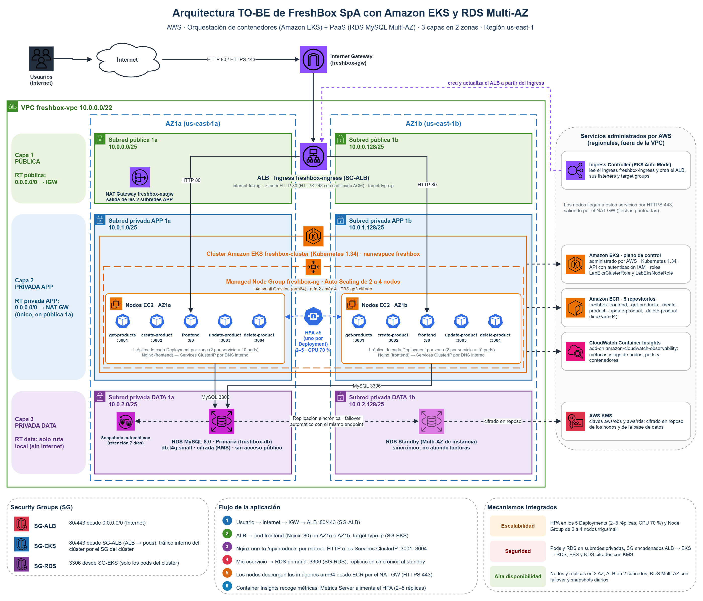

# EV2 — EP2 ARY1102 · FreshBox SpA en Amazon EKS + RDS Multi-AZ

Modernización de la arquitectura de EV1. Los cinco contenedores que corrían con Docker en las EC2 del Auto Scaling Group pasan a Amazon EKS: un Managed Node Group de 2 a 4 nodos `t4g.small`, cinco Deployments con dos réplicas cada uno y un HPA por Deployment. La base MySQL que corría en una EC2 pasa a Amazon RDS MySQL `db.t4g.small` Multi-AZ, cifrada y con snapshots automáticos. La red de tres capas es la misma de EV1 (VPC `10.0.0.0/22`, seis subredes `/25` en dos AZ).

Todo se levanta con Terraform y se despliega desde GitHub Actions **sin push** (Actions → Run workflow), o desde el PC con los mismos scripts.

## Diagrama TO-BE

[](diagramas/D1_FreshBox_EKS_TOBE.png)

Editable en [`diagramas/D1_FreshBox_EKS_TOBE.drawio`](diagramas/D1_FreshBox_EKS_TOBE.drawio). Qué muestra cada parte y en qué se aparta de la tabla de la pauta: [`diagramas/README.md`](diagramas/README.md).

## Estructura

```
.github/workflows/                     (raíz del repo)
└── ep2-freshbox.yaml                  EP2 · FreshBox (EKS + RDS): único workflow de EP2 ← Run workflow (acción a elegir)
EV2/
├── infra/freshbox-ep2/                Terraform: main, network, security, ecr, eks, rds, variables, outputs
├── app/                               frontend Nginx + 4 microservicios Node + init.sql + docker-compose.yml
│   └── scripts/ecr-push.sh            build linux/arm64 y push de las 5 imágenes
├── k8s/                               manifiestos con marcadores (<ECR_REGISTRY>, <IMAGE_TAG>, <RDS_ENDPOINT>, <SG_ALB_ID>)
│   ├── 00-namespace · 01-configmap · 02-secret.example · 03-migrar-datos-job
│   ├── <servicio>/                    deployment, service y hpa de cada uno de los 5 servicios
│   ├── pdb.yaml                       PodDisruptionBudget por servicio
│   └── ingressclass.yaml · ingress.yaml
├── script/
│   ├── bootstrap-tfstate.sh           bucket S3 + tabla DynamoDB del estado (los mismos de EV1)
│   ├── aplicar-k8s.sh                 completa los manifiestos con las salidas de Terraform y los aplica
│   ├── probar-crud.sh                 GET, POST, PUT y DELETE por el ALB
│   ├── carga-hpa.sh                   carga sobre get-products para ver escalar el HPA
│   └── bajar-k8s.sh                   retira el ALB del Ingress antes de terraform destroy
└── diagramas/                         D1 TO-BE (draw.io, PNG, SVG y generador)
```

## Qué cambia respecto de EV1

| Aspecto | EV1 (EC2 + Docker) | EV2 (EKS + RDS) |
|---|---|---|
| Cómputo | ASG de EC2; el user data descarga las imágenes y levanta los 5 contenedores | Managed Node Group; Kubernetes reparte los pods y los reinicia si fallan |
| Actualización | rolling manual terminando EC2 de a una (el lab bloquea instance refresh) | rolling update de cada Deployment, sin cortar el servicio |
| Escalado | el ASG agrega instancias completas por CPU promedio | HPA por servicio (2 a 5 réplicas) dentro de un Node Group de 2 a 4 nodos |
| Entrada | ALB de Terraform hacia las EC2 :80 | ALB creado por el Ingress (EKS Auto Mode) hacia las IP de los pods frontend |
| Base de datos | MySQL en una EC2 con AWS Backup diario; contingencia restaurando en 1b | RDS Multi-AZ: standby sincrónico, failover automático con el mismo endpoint, snapshots de 7 días |
| Red Data | ruta al NAT (la EC2 descargaba su imagen) | sin salida a Internet |
| Credenciales | `alumno123` en `variables.tf` | clave aleatoria generada por Terraform, llevada a un Secret sin pasar por Git |
| Imágenes | Node 18 como root | Node 22 con usuario sin privilegios, tag por commit |

## Decisiones por las limitaciones del Learner Lab

- **Roles IAM.** El lab no deja crear roles. El clúster usa `LabEksClusterRole` y los nodos `LabEksNodeRole`, que Terraform busca por nombre (llevan prefijo y sufijo aleatorios).
- **Ingress Controller.** El AWS Load Balancer Controller necesita su propio rol (IRSA). Se usa el controlador de ALB de **EKS Auto Mode**, el mismo que validó el docente en la actividad 2.3. Auto Mode queda habilitado solo para el balanceo (`node_pools = []`); los nodos son los del Managed Node Group.
- **Dos nodos deseados (mínimo 2, máximo 4).** El Node Group parte con el mínimo y el HPA agrega réplicas dentro de esos dos nodos. Sin ajustes un `t4g.small` admite 11 pods (3 ENI × 3 IP + 2), y en dos nodos no caben los 10 pods de la app junto a CoreDNS, Metrics Server y los agentes de Container Insights. Por eso:
  - el VPC CNI usa **prefix delegation** (cada ranura de IP recibe un prefijo `/28`). Al crear el node group, EKS lo detecta y sube `maxPods` de 11 a 110, el tope para instancias de menos de 30 vCPU. Desde ahí el límite es la CPU y la memoria de cada nodo;
  - el launch template reserva memoria para el kubelet según los pods que caben de verdad (`node_pods_reserva = 24`, fórmula de AWS 255Mi + 11Mi por pod), porque por defecto la AMI la calcula para 11;
  - los pods piden **64Mi** de memoria (el límite sigue en 256Mi), así que la memoria de los nodos alcanza para las réplicas extra.

  Según el cálculo, en los dos nodos caben los 10 pods mínimos y unas 15 réplicas más, limitadas por la CPU reservada (100m por pod). Se confirma con `kubectl describe nodes` (bloque *Allocated resources*). Prefix delegation necesita bloques `/28` libres en las subredes App: en un despliegue nuevo están casi vacías, pero activarlo sobre un clúster que ya tiene pods puede fallar con `InsufficientCidrBlocks`.
- **Escalado de nodos.** El mínimo y el máximo del Node Group son límites. Para que agregue nodos por sí solo hace falta un Cluster Autoscaler, que necesita permisos IAM que el lab no da. En la demostración se escala a mano (abajo) y el HPA es el escalado automático.
- **API de EKS pública con autenticación IAM** (`0.0.0.0/0`), para que la pipeline de GitHub pueda usar `kubectl`. Se puede limitar con `eks_public_access_cidrs`.
- **HTTP sin TLS.** El SG-ALB permite 443 como pide la pauta, pero el lab no tiene dominio ni certificado ACM para un listener HTTPS.
- **El ALB no lleva etiquetas propias** (`Project`, `Env`...). Auto Mode crea el ALB, el listener y sus reglas con `LabEksClusterRole`, y su política (`AmazonEKSLoadBalancingPolicy`) solo acepta claves `eks:eks-cluster-name` e `ingress.eks.amazonaws.com/*` en esas creaciones. Con la anotación `alb.ingress.kubernetes.io/tags` el controlador recibe `AccessDenied` en `CreateRule`.
- **Un NAT Gateway**, igual que en EV1. Solo lo usa el tráfico que sale de los nodos; los usuarios entran por el IGW al ALB.

## Cada sesión del Learner Lab (GitHub Actions)

Todo se hace desde un solo workflow, **EP2 · FreshBox (EKS + RDS)** (`ep2-freshbox.yaml`), eligiendo la acción al lanzarlo:

| Acción | Hace | Tiempo aprox. |
|---|---|---|
| `desplegar` | `terraform apply` con el clúster → 5 imágenes arm64 a ECR → manifiestos en EKS → prueba CRUD por el ALB. Sirve también para actualizar todo | 35–45 min la primera vez |
| `actualizar-app` | solo imágenes, manifiestos y prueba CRUD (la infraestructura ya existe) | 8–12 min |
| `infraestructura` | solo `terraform apply`; con **crear_eks** desmarcado deja solo la base (red, SG, ECR y RDS) y quita el clúster si existía | 20–30 min |
| `plan` | `terraform plan`, sin aplicar | 1–2 min |
| `eliminar` | retira el ALB del Ingress, `terraform destroy` y borra los logs de Container Insights | 15–20 min |
| `validar` | terraform validate, docker build arm64, kubeconform y shellcheck (también corre solo en cada push o PR que toque EV2) | 5 min |

1. Iniciar el lab → **AWS Details → AWS CLI: Show** y actualizar los secretos `AWS_ACCESS_KEY_ID`, `AWS_SECRET_ACCESS_KEY` y `AWS_SESSION_TOKEN` del repositorio (igual que en EV1).
2. Actions → **EP2 · FreshBox (EKS + RDS)** → Run workflow → `desplegar`. EKS y RDS Multi-AZ se crean en paralelo, luego los nodos, las imágenes y los manifiestos. El resumen del run muestra la URL del ALB y la prueba CRUD.
3. Al terminar: el mismo workflow con `eliminar`.

**Infraestructura en dos etapas (opcional).** La acción `infraestructura` con **crear_eks** desmarcado crea solo la base; otra vez con la casilla marcada agrega el clúster EKS con su Node Group y add-ons. Desmarcarla con el clúster arriba lo quita (antes retira el ALB del Ingress) y conserva la base y los datos de RDS, lo que ahorra créditos mientras no se trabaja con Kubernetes. `desplegar` siempre crea el clúster, porque la app lo necesita.

Si un job falla con `ExpiredToken`, se renuevan los secretos y se relanza.

## Ejecución local desde un clon

Requisitos: Terraform ≥ 1.10, AWS CLI v2, kubectl, Docker con Buildx y bash (en Windows, Git Bash), con el bloque de **AWS CLI: Show** del lab en `~/.aws/credentials`.

```bash
./EV2/script/bootstrap-tfstate.sh                     # bucket y tabla del estado (si cambió la cuenta, indica qué poner en main.tf)
terraform -chdir=EV2/infra/freshbox-ep2 init
terraform -chdir=EV2/infra/freshbox-ep2 apply         # ~25 min (con -var create_eks=false, solo la base sin clúster)
./EV2/app/scripts/ecr-push.sh                         # 5 imágenes linux/arm64, tag = commit actual
./EV2/script/aplicar-k8s.sh                           # ConfigMap, Secret, migración, Deployments, Ingress, HPA
./EV2/script/probar-crud.sh                           # GET, POST, PUT, DELETE por el ALB
```

Para bajar todo:

```bash
./EV2/script/bajar-k8s.sh
terraform -chdir=EV2/infra/freshbox-ep2 destroy
```

Prueba local de la app, sin AWS: `cd EV2/app && docker compose up -d --build` → http://localhost:8080.

## Verificación para la demostración

| Pauta | Comando o lugar en la consola |
|---|---|
| Clúster y nodos en 2 AZ | `kubectl get nodes -L topology.kubernetes.io/zone,node.kubernetes.io/instance-type` |
| Capacidad por nodo (PODS en 110; con 11 no se activó prefix delegation) | `kubectl get nodes -o custom-columns=NODO:.metadata.name,PODS:.status.allocatable.pods,CPU:.status.allocatable.cpu,MEMORIA:.status.allocatable.memory` |
| 5 Deployments, 10 pods | `kubectl get deploy,pods -n freshbox -o wide` |
| Services ClusterIP e Ingress con DNS del ALB | `kubectl get svc,ingress -n freshbox` |
| Imágenes en ECR | `aws ecr describe-images --repository-name freshbox-get-products --query 'imageDetails[].imageTags'` |
| RDS Multi-AZ en detalle | `aws rds describe-db-instances --db-instance-identifier freshbox-db --query 'DBInstances[0].{Clase:DBInstanceClass,MultiAZ:MultiAZ,Primaria:AvailabilityZone,Standby:SecondaryAvailabilityZone,Cifrada:StorageEncrypted,Retencion:BackupRetentionPeriod,Publica:PubliclyAccessible}'` |
| Migración de datos | `kubectl logs job/migrar-datos-ep1 -n freshbox` |
| CRUD por el ALB | `./EV2/script/probar-crud.sh` o el navegador en la URL del ALB |
| HPA escalando | `./EV2/script/carga-hpa.sh` y, en otra terminal, `kubectl get hpa -n freshbox -w` |
| Métricas | `kubectl top nodes` · `kubectl top pods -n freshbox` · CloudWatch → Container Insights |
| Escalar el Node Group | `aws eks update-nodegroup-config --cluster-name freshbox-cluster --nodegroup-name freshbox-ng --scaling-config minSize=2,maxSize=4,desiredSize=4` |

## Estado en el Learner Lab

Primer despliegue completo (2026-10-24, acción `desplegar`):

- Terraform creó la red, RDS Multi-AZ y el clúster con los add-ons administrados (vpc-cni, kube-proxy, CoreDNS, Metrics Server, Container Insights): 3 nodos `t4g.small` arm64 `Ready` con Kubernetes 1.34.
- El Job `migrar-datos-ep1` terminó, los 10 pods quedaron `Running` repartidos en los 3 nodos y los 5 HPA leen la CPU de los pods.
- El ALB `freshbox-eks-alb` se creó (Auto Mode respetó el nombre), pero el controlador no pudo crear la regla del listener: `AccessDenied` en `elasticloadbalancing:CreateRule`, por las etiquetas propias del Ingress (ver decisiones). Se quitaron, y `aplicar-k8s.sh` ahora borra y recrea un Ingress que quedó sin DNS.

Por confirmar en el siguiente despliegue:

- **CRUD por el ALB** y que el ALB quede con `freshbox-sg-alb` (EC2 → Load Balancers → `freshbox-eks-alb` → Security).
- **Container Insights.** El agente usa el rol del nodo. Revisar si `LabEksNodeRole` tiene `CloudWatchAgentServerPolicy`:
  `aws iam list-attached-role-policies --role-name "$(aws iam list-roles --query "Roles[?contains(RoleName,'LabEksNodeRole')].RoleName" --output text)"`.
  Si no la tiene y el lab no deja adjuntarla, los pods del add-on corren pero no publican métricas; la infografía de la pauta permite documentar la restricción y mostrar `kubectl top` y las métricas del ALB y de RDS.
